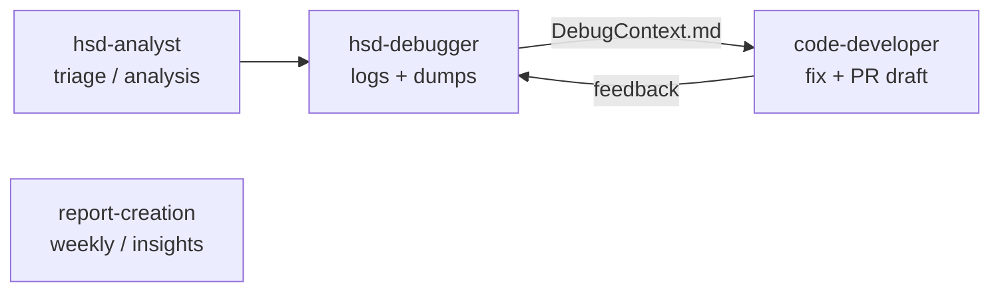

# AiEnvironment

Reusable AI infrastructure for C++ development, debug ownership, and HSD request handling.

## Structure

| Folder | Purpose |
|--------|---------|
| `McpServers/` | Reusable MCP servers (see below). |
| `Agents/` | Custom agent personas/modes (`*.agent.md`, see below). |

## MCP servers

Both servers below are registered in the user-scope `mcp.json`
(`%APPDATA%\Code\User\mcp.json`) and run directly from `C:\AiEnvironment\McpServers\...`, so
editing the source file is enough (restart the server from **MCP: List Servers** afterwards).
The server key in `mcp.json` is the namespace agents use in their `tools:` frontmatter.

### HsdServer_SupportQuery

Server file: `McpServers/HsdServer_SupportQuery/hsd_server_support_query.py`
(see its [README](McpServers/HsdServer_SupportQuery/README.md) for details and troubleshooting).

**Purpose**

Companion to the base `hsd` server. Adds HSD-ES **saved query** support (by `queryId`) and fast
triage of new/unattended tickets. It also reconstructs article **comments** and the current
**status/reason** from the article history endpoint, because the base server's comments endpoint
is unreliable and its `reason` field often comes back empty. Authentication is reused from the
external `HsdSearcher` class (Kerberos / NTLM / bearer).

**Tools**

| Tool | Purpose |
|------|---------|
| `hsd_run_saved_query(query_id, max_results)` | Full member list of a saved query. Large output: parse it in the terminal (python/jq), not with grep. |
| `hsd_count_saved_query(query_id)` | Number of articles in a saved query. |
| `hsd_saved_query_field_stats(query_id, field, top, filter_field, filter_value, filter_field2, filter_value2)` | Counts of the values of one field (e.g. `owner`, `status`, `release`), with up to 2 ANDed filters. Totals only, no per-ticket rows. |
| `hsd_filter_saved_query(query_id, filter_field, filter_value, filter_field2, filter_value2, fields, sort_by, limit)` | Fast filtered list: up to 2 ANDed filters, sorted by `open_date` newest first. Returns short rows with `title`, `updated_by`, `days_open`, `days_since_submitted`. |
| `hsd_triage_new_unattended(query_id, release, component, limit_per_group)` | One-call triage: new/clone tickets, unattended tickets (new/clone or customer updated last) and the Bug / Enhancement / Consultation / Sighting counts. Team roster is built into the server. |
| `hsd_get_article_comments(article_id, max_results)` | Comment thread (oldest first) plus the current `status`, `reason`, `owner`, `updated_by`, `updated_date` and `rev`. Use this as the trusted source for ticket state. Accepts an ID or an article URL. |

> Ad-hoc HQL / search tools (`hsd_search_hql`, `hsd_search`, `hsd_search_by_product`) do not return
> rows on this tenant. Use saved-query tools or per-ID `hsd_get_article` instead.

**Requirements**

1. **External hsdAgent project** at
   `C:\Users\jareyesr\.copilot\applications.manufacturing.intel.ai.agents\hsdAgent` (provides
   `hsd_searcher.py`). Override with `EXTERNAL_HSD_DIR`. The external code is only imported,
   never modified.
2. **Python packages** from [requirements.txt](McpServers/HsdServer_SupportQuery/requirements.txt):
   `requests`, `mcp`, `requests-kerberos`, `requests-ntlm`. Currently runs on the hsdAgent venv.
3. **Intel network or VPN** and HSD-ES access for your account.
4. **Environment variables**: `HSD_AUTH_METHOD` (`kerberos` default, `ntlm`, `bearer`),
   `HSD_PAT` (only for `bearer`), `VERIFY_SSL` (`false` default), `HSD_BASE_URL`
   (default `https://hsdes.intel.com`), `SAVED_QUERY_CACHE_TTL` (seconds, default `120`).

**Registration** (user-scope `mcp.json`):
```json
"HsdServer_SupportQuery": {
  "type": "stdio",
  "command": "<hsdAgent>/.venv/Scripts/python.exe",
  "args": ["C:/AiEnvironment/McpServers/HsdServer_SupportQuery/hsd_server_support_query.py"],
  "env": {
    "EXTERNAL_HSD_DIR": "<hsdAgent>",
    "HSD_AUTH_METHOD": "kerberos",
    "VERIFY_SSL": "false"
  }
}
```
In agent frontmatter, reference the whole server (`hsdserver_supportquery`) rather than single
tools, so VS Code does not drop the tools when the server is briefly stopped.

**Usage examples** (chat prompts)

- "How many tickets are in the HSD query?" → `hsd_count_saved_query("14025907745")`
- "List new Galaxy HSDs with days open" → `hsd_triage_new_unattended("14025907745", release="Galaxy")`
- "Show unattended Solar HSDs" → `hsd_triage_new_unattended("14025907745", release="Solar")`
- "Who owns most Galaxy tickets?" →
  `hsd_saved_query_field_stats("14025907745", field="owner", filter_field="release", filter_value="Galaxy")`
- "List Galaxy tickets with reason=new" →
  `hsd_filter_saved_query("14025907745", filter_field="reason", filter_value="new", filter_field2="release", filter_value2="Galaxy")`
- "What's the latest comment and current reason on 14028408653?" →
  `hsd_get_article_comments("14028408653")`

### IntelWikiAccess

Server file: `McpServers/IntelWikiAccess/intel_wiki_access.py`

**Purpose**

Read-only access to the Intel Confluence wiki (`wiki.ith.intel.com`): read pages, run CQL
searches, and compute release-page statistics (bug fixes / enhancements per release).

**Tools**

| Tool | Purpose |
|------|---------|
| `wiki_get_page(page, max_chars)` | Reads a page as plain text. Accepts a page ID or any wiki page URL. |
| `wiki_search(cql, max_results)` | Runs a CQL search; returns ID, title and created date per result. |
| `wiki_release_stats(product, space, months, sections, include_per_release)` | Min/max/avg/total of Bug Fixes, Enhancements and Combined items across `<product> 1.<yy>.<WW><d> Release` pages (e.g. `1.26.476` = 2026 WW47 day 6). Errata/Notes are excluded. Use `sections="Galaxy"` for Galaxy-only counts. |

**Requirements**

1. **Wiki token in `CONFLUENCE_PAT`**: create a Confluence Personal Access Token
   (wiki > profile picture > Settings > Personal Access Tokens) and store it as a Windows
   *user* environment variable named exactly `CONFLUENCE_PAT`. Type this in your own terminal,
   never in chat:
   ```powershell
   [Environment]::SetEnvironmentVariable("CONFLUENCE_PAT", "<token>", "User")
   ```
   If VS Code started before the variable existed, the server reads it from the Windows user
   environment (`HKCU\Environment`) directly. Renew the token before it expires.
2. **Python 3.10 or newer** (the code uses `str | None` type syntax). Currently runs on the
   hsdAgent venv (Python 3.13).
3. **`mcp` Python package** (FastMCP, version 1.0 or newer; tested with 1.12.0):
   `pip install "mcp>=1.0.0"`. Everything else is from the Python standard library.
4. **Intel network or VPN** to reach `wiki.ith.intel.com`.
5. **Wiki permissions**: the server only sees pages your wiki account can see. All calls are read-only.
6. **Optional `WIKI_BASE_URL`**: defaults to `https://wiki.ith.intel.com`. The token is only sent to this host.

**Registration** (user-scope `mcp.json`):
```json
"IntelWikiAccess": {
  "type": "stdio",
  "command": "<path-to-python-with-mcp>/python.exe",
  "args": ["C:/AiEnvironment/McpServers/IntelWikiAccess/intel_wiki_access.py"],
  "env": { "WIKI_BASE_URL": "https://wiki.ith.intel.com" }
}
```
It is used directly from the default chat mode (no custom agent). To use it from an agent, add
`IntelWikiAccess` to the agent's `tools:` frontmatter.

**Usage examples** (chat prompts)

- "Read wiki page 123456789" or "Summarize `<wiki page URL>`" → `wiki_get_page("<id or URL>")`
- "Find Galaxy release pages created this year" →
  `wiki_search('space = "Galaxy" AND title ~ "Release" AND created >= "2026-01-01"')`
- "Average Galaxy bug fixes per release over the last 6 months" →
  `wiki_release_stats(product="Galaxy", space="Galaxy", months=6, sections="Galaxy")`
- "Per-release breakdown for the last 3 months" →
  `wiki_release_stats(months=3, include_per_release=True)`

## Agents

Agent files live in `Agents/` and are published by copying them to
`%APPDATA%\Code\User\prompts\<name>.agent.md`. Pick the agent from the chat mode dropdown.
Per-issue work happens outside this repo in `C:\HSDs\<HSD-ID>_<slug>\`. The HSD agents read
the HSD ID from that folder name, so open the folder (or `cd` into it) before starting.



### hsd-analyst

**Purpose**: HSD support-query analyst with two jobs:
1. **Deep-dive one ticket or query**: reads the description and comments, classifies it (Bug /
   Enhancement / Consultation / Sighting), reports current status and reason, and gives
   evidence-based root-cause guesses plus next debug steps.
2. **List HSDs by category**: new (reason `new`/`clone`, with days open), unattended (new/clone
   or a customer updated last), and Bug / Enhancement / Consultation breakdowns. Every listed
   ticket is tagged with its category.

Uses the default saved query `14025907745` (aliases: HSD query, Galaxy query, Solar query, PCCS
query, HSD list). "Galaxy" or "Solar" adds a `release` filter. Tells team members apart from
customers using a built-in team roster.

**Tools**: `hsd` (article/attachments/history), `HsdServer_SupportQuery`, workspace read/search.

**Usage examples**
- In `C:\HSDs\14028408653_EntryExitTime_Offset`: "Analyze this HSD."
- "List the new Galaxy HSDs."
- "Which Solar HSDs are unattended?"
- "Break down the HSD query by Bug / Enhancement / Consultation."
- "What's the current status and reason of 14028408653?"

### hsd-debugger

**Purpose**: Hands-on Galaxy debug specialist. Reads log files (`GalaxyLog.log`,
`GalaxyLogServerListen.log`, test `/cfg`) and crash dumps. It works out the test scenario and
mode (HOST vs SUT), finds patterns across iterations, confirms the failure and defines a repro.
Only after that, and only when asked, does it correlate with C++ source; it asks first which repo
to use (`1_galaxy` or `2_galaxy`).
Read-only: it never edits or runs code. The one exception is writing `DebugContext.md` in the HSD
folder to hand the case over to `code-developer`. For a separate chat session, it gives export
instructions.

**Tools**: terminal (read-only inspection), `hsd` (article/attachments/history),
`HsdServer_SupportQuery`, workspace read/search.

**Usage examples**
- In the HSD folder: "Investigate the logs for this HSD."
- "Compare `GalaxyLog.log` against `GalaxyLogServerListen.log` around the failing iteration."
- "Analyze the crash dump `Galaxy.dmp`." (it asks for symbols/binaries first)
- "Correlate the failure with code in `1_galaxy`."
- "Root cause confirmed, write DebugContext.md for handoff."
- "Which pattern is observed across failing log-files vs passing log-files?"

### code-developer

**Purpose**: Implements C++ fixes. It runs in two modes:
- **HSD-driven**: reads `DebugContext.md` from `C:\HSDs\<id>_<slug>\`.
- **Standalone**: you describe the problem directly.

It checks that the findings are complete and that the fix addresses the root cause, and it reuses
existing functions where it can. Code comments are kept to 2 lines at most; the reasoning goes in
`IMPLEMENTATION_NOTES.md`. Validation is recorded in `VALIDATION.md`. It reads git context (branch,
commits, `origin/development` target) and drafts `PR_DRAFT.md` for you to copy and paste. It never
calls the GitHub API. Read-only git commands run without asking; history-changing commands (commit,
push, reset) need your approval. Includes import/export instructions for continuing in a new chat.

**Tools**: workspace read/edit/search, terminal, `hsd` (article/attachments/history),
`HsdServer_SupportQuery`.

**Usage examples**
- In the HSD folder: "Load the debug context." (only loads and summarizes, no changes)
- "Implement the suggested fix."
- "Validate the fix against the root cause."
- "Draft the PR."
- Standalone: "Refactor `<function>` in `<file>` to remove the duplicated retry logic; root cause: ..."

### report-creation

**Purpose**: Personal reporting assistant. Drafts:
- **Weekly report** (last 7 days): 3-4 highlights, 3-4 concerns, and a 2-3 item plan for the
  next 2 weeks. Each section has *Selected* and *Additional options*. Also tracks Teams call
  requests and items carried over. Saved to `C:\Reports\Weekly\WW<ww>.md` (ISO week number).
- **Insights report** (trimester/semester, you give the dates): accomplishments, measurable
  deliverables, personal growth, and impact on the tools, the team and customers. It asks for a
  report name and saves to `C:\Reports\<name>\<name>.md`.

It uses data from HSD (owned/updated tickets, WIP), Outlook (`HSD` folder update emails, GitHub PR
mails in the `Solar3 Github` / `Galaxy Github` folders), and Teams (only conversations you took
part in or were mentioned in). M365/HSD calls and writing to `C:\Reports\` are pre-approved.

**Tools**: `hsd`, `HsdServer_SupportQuery`, `m365-graph`, workspace read/edit/search.

**Usage examples**
- "Create my weekly report."
- "Draft the weekly report for WW47."
- "Create an Insights report from 2026-05-01 to 2026-08-31."
- "Add the PRs I reviewed this week to the highlights options."

## Publishing

After any change:
- **Agents**: copy `Agents/<name>.agent.md` to `%APPDATA%\Code\User\prompts\<name>.agent.md`.
- **MCP servers**: no copy needed (they run from this repo). Restart the server and open a
  **new chat** so the tools bind to it.
